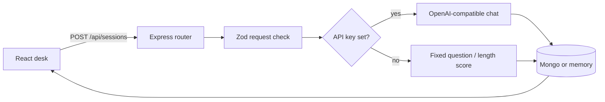

# Developer notes

This file is the map of the code. Read it before changing a route or the prompt. The product explanation for someone running the app is in [README.md](README.md).

## Shape

Two packages, one repo, npm workspaces.

```text
client/     React + Vite + Tailwind. Talks only to /api.
server/     Express. Owns validation, the model, and storage.
```

The client does not import server files. The session contract is duplicated in `client/src/types.ts` and `server/src/types.ts` on purpose. A shared package would be a third workspace for one interface. If you add a field, change both types and the Zod schema that actually enforces the model output.



## Request path

1. `client/src/App.tsx` submits the start form or the answer form through `client/src/api.ts` (axios).
2. `server/src/routes/sessions.ts` parses the body with Zod. A failed parse is a 400 with one sentence.
3. `generateQuestion` or `scoreAnswer` in `server/src/ai/coach.ts` either calls the model or the heuristic.
4. The store inserts or updates. The response is the saved record, including its id.
5. Errors from the store or an unexpected throw hit the handler in `server/src/app.ts` and become a 500 `{ error }`.

`GET /api/health` is how the header knows whether it is showing a model name or the words "offline coach". The handler does not return the API key.

## Model contract

Two schemas, both returned as JSON:

- Question call: `{ question: string }` (10–500 chars).
- Score call: `{ score: number (1–5), feedback: string, followUp: string }`.

`source` and `model` are set by our code after parsing. The model is not allowed to claim it is the offline coach, and the offline coach is not allowed to claim it is a model.

Flow inside the model helpers:

1. Ask with `response_format: json_object`.
2. If that flag is rejected, retry the same prompt without it.
3. Strip optional markdown fences in `extractJson` and run Zod.
4. On invalid JSON, ask once more, quoting a clipped reason.
5. If that still fails, or the HTTP call fails, return the heuristic result. The badge still says the result is offline.

The system prompts forbid invented employers, projects, metrics, or skills that are not in the resume snippet. Zod checks shape, not truth.

Temperature is `0.3`.

## Offline coach

- `heuristicQuestion` uses a fixed behavioral template that includes the role title. If the resume snippet is longer than 40 characters it switches to a project-contribution prompt.
- `heuristicScore` counts words. Under 8 words → 1, 8–20 → 2, 20–40 → 3, over 40 → 4. Feedback and follow-up are fixed sentences. It never claims to have read the resume for content.

## Storage

`SessionStore` in `server/src/types.ts` is the seam: `insert`, `list`, `get`, `update`, `remove`.

- `createMemoryStore` keeps an array in the process. Newest first. Used when `MONGO_URI` is empty so `npm run dev` works with zero infrastructure. Data dies with the process.
- `createMongoStore` connects with Mongoose and maps `_id` to `id` at the edge. `update` merges the patch into `result` and saves.

`connectStore` is the only place that chooses. Routes take a `SessionStore`.

Documents are not user-scoped. There is no account system.

## UI

`App` holds the selected session id. The list comes from React Query (`queryKey: ["sessions"]`). Mutations invalidate that key. `isPending` disables the buttons.

The answer box is a `react-hook-form` form (`useForm`, `register`, `handleSubmit`). Server state stays in React Query; the form is only client-side input.

Timestamps use `format` from date-fns.

All styling is Tailwind utilities. There is no hand-written CSS design system.

## Library notes

- **Tailwind CSS** (`@tailwindcss/vite`): utility classes for layout, color, and spacing. Used in `client/src/App.tsx`. Interview question: why not a component library or a large CSS file? Answer: the page has one primary action; utilities keep the styling local and the bundle small.
- **date-fns**: formats every timestamp the user sees. `format(new Date(createdAt), "MMM d, yyyy · h:mm a")` in `client/src/App.tsx` returns a string like "Nov 11, 2026 · 4:40 AM". Interviewers still say "moment"; the answer is: Moment is legacy, mutable, and heavy; this repo uses date-fns.
- **axios**: every API call. `client/src/api.ts` creates an instance with `baseURL: "/api"`. Interview question: why not raw `fetch`? Answer: consistent error handling and interceptors if we add auth later; the code already shows the pattern.
- **@tanstack/react-query**: loading, creating, and deleting server data. `useQuery({ queryKey: ["sessions"], queryFn: listSessions })` and `qc.invalidateQueries({ queryKey: ["sessions"] })` after a write. `isPending` on the mutations. Interview question: why not keep the list in `useState`? Answer: React Query owns the server cache, loading, and invalidation; we do not duplicate it.
- **zod**: request bodies and model JSON on the server. `startSchema` and `answerSchema` in `server/src/routes/sessions.ts`, `questionSchema` and `scoreSchema` in `server/src/types.ts`. Interview question: where do you validate? Answer: at the edge, before any model call or store write.
- **helmet**: `app.use(helmet())` in `server/src/app.ts`. Interview question: what is a basic Express security header? Answer: helmet sets a sensible default set (X-Content-Type-Options, etc.).
- **cors**: `app.use(cors())` in the same file. Required for the Vite dev server.
- **react-hook-form**: the answer box. `useForm<AnswerForm>()` and `register("answer")` in `client/src/App.tsx`. Interview question: why not a controlled `useState` for every input? Answer: the form library handles validation and submission; we only need it for the one answer field that is submitted to the server.

Redux Toolkit is for a large shared client cache this app does not have. React Query plus the form library is enough.

## Tradeoffs

- In-memory fallback makes the repo runnable in a portfolio review. It is the wrong store for anything private or multi-instance.
- Falling back to the heuristic when the model fails keeps the demo alive. It can also hide a bad key. The badge is the signal.
- Duplicated types will drift if you only edit one side. The API response is the runtime contract.
- `Mixed` for the Mongo result is deliberate. The result shape is owned by Zod at write time.

## Interview walkthrough

If someone asks you to explain this repo, walk this path and stop where they interrupt:

1. The UI never calls a model. It only posts text to Express.
2. Zod rejects short or huge payloads before any token is spent.
3. The model must return JSON. We parse it, check it, and retry once.
4. We label heuristic results so a missing API key cannot look like GPT.
5. Mongo is optional behind a store interface. Tests hit the memory implementation and the heuristic.
6. There is no auth, so the README tells you not to deploy it with real resume text.
7. The answer form is react-hook-form; the session list is React Query. We do not keep a second copy of the server list in useState.

## What I would not add next without a reason

Multi-turn conversation, a full scoring rubric with sub-scores, or login. Each one is a new product. The current gap that matters is better offline scoring, not more screens.
